<p align="center">
  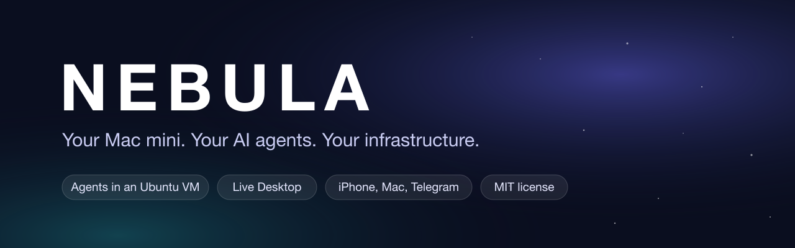
</p>

<h1 align="center">NEBULA</h1>

<p align="center">
  A self-hosted platform that runs teams of AI agents on an Apple-silicon Mac, each with its own Linux desktop
  inside a local virtual machine that you can watch and take over.<br>
  <strong>Your Mac mini. Your AI agents. Your infrastructure.</strong>
</p>

<p align="center">
  <a href="LICENSE"></a>
  <a href="https://github.com/ond1ej/NEBULA_v1/actions/workflows/ci.yml"></a>
  
  
</p>

NEBULA turns a Mac you already own into a private host for AI agents. A Python service on the Mac runs the agents,
keeps their state in a local SQLite database and their secrets in the macOS Keychain. The agents do their work inside
one Ubuntu virtual machine built with Apple's Virtualization framework, where every agent is a separate Linux user with
its own XFCE desktop, Chromium profile and workspace. You control everything from a local web dashboard, and
optionally from Telegram, a Telegram Mini App, or the native iPhone and Mac apps over your own Tailscale network.

There is no NEBULA cloud service. Cloud AI providers and Telegram are third-party services that you choose to connect,
under their own terms and costs.

> **Status: 1.0.0, first public release.** This is an unsigned developer build that you build from source. Features
> are labelled **Stable**, **Experimental** or **Planned** below, and the labels mean what they say.

## Contents

[Features](#features) · [Screenshots](#screenshots) · [Quick start](#quick-start) ·
[Requirements](#system-requirements) · [Installation](#installation) · [First run](#first-run) ·
[AI providers](#ai-providers) · [Tailscale remote access](#remote-access-with-tailscale) ·
[Live Desktop](#live-desktop) · [iOS companion app](#ios-companion-app) · [Architecture](#architecture) ·
[Security model](#security-model) · [Troubleshooting](#troubleshooting) · [Roadmap](#roadmap) ·
[Contributing](#contributing) · [License](#license)

## Features

- **Agents with real desktops.** Each agent gets its own Linux account, XFCE desktop and headed Chromium inside a
  shared Ubuntu 24.04 ARM64 VM. Agents browse, use a terminal, edit files and run tools there, not on your Mac.
- **Live Desktop with Take Control.** Watch an agent's screen in the browser, take mouse and keyboard while the agent
  pauses its GUI actions, then hand control back. Nothing is streamed until you press Connect.
- **Approvals for risky actions.** Payments, sending messages, uploads, privileged commands, mass deletes and similar
  actions wait for your decision, and only you, the owner, can give it, in every app and in every Telegram chat.
  Sensitive approvals (payments, credentials, privileged commands, anything on the Mac) need a fresh verification and
  are never decided by a Telegram button. A denial is remembered for the rest of the task.
- **Your choice of model.** Local models through Ollama, OpenAI, Anthropic and Gemini API keys, any
  OpenAI-compatible endpoint, and the official "Sign in with ChatGPT" flow for local open-source clients.
- **Automation.** Long-term memory per agent, teams with hand-offs, schedules (cron, time zones, misfire policy), a
  visual workflow builder, a file manager for workspaces, skills and local plugins.
- **Password Vault and Smart sign-in.** An encrypted local vault (Argon2id + AES-256-GCM) lets an agent sign in to a
  website through an isolated browser without ever seeing the password.
- **Remote control on your terms.** The dashboard binds to `127.0.0.1`. Remote access goes through a separate,
  authenticated gateway that is off by default, with Tailscale Serve (tailnet only) as the recommended path.
- **Telegram and native apps.** A Telegram bot, an optional bot per agent, a Telegram Mini App, and SwiftUI apps for
  iPhone, iPad and Mac (in the separate [NEBULA-iOS](https://github.com/ond1ej/NEBULA-iOS) repository) with Secure
  Enclave device keys.

### What works today

| Area | Feature | Status | Evidence |
|---|---|---|---|
| Install | CLI installer: preflight, signed and hash-pinned Ubuntu image, VM creation, guest provisioning, health check, repair, uninstall | Stable | `tests/unit/test_policy_and_qcow2.py`, hardware harness `scripts/e2e.py` |
| VM | One shared Ubuntu VM, per-agent Linux users, XFCE desktops, headed Chromium | Stable | `tests/unit/test_rpc_and_guest.py`, hardware harness |
| Agents | Task state machine, policy and approvals, checkpoints, pause/resume/stop, verified completion | Stable | `tests/integration/test_api.py`, `tests/security/test_security.py` |
| Live Desktop | View, Take Control, Release Control in the local dashboard | Stable | `tests/integration/test_api.py`, dashboard `LiveDesktop.test.tsx`, hardware harness |
| Providers | Ollama (local) | Stable | `tests/unit/test_providers.py`, hardware harness |
| Providers | OpenAI, Anthropic and Gemini API keys, OpenAI-compatible endpoints | Experimental: contract-tested with mocked HTTP, not verified against the live APIs in this release | `tests/unit/test_providers.py` |
| Providers | Sign in with ChatGPT (OpenAI's documented flow for local open-source clients) | Experimental: depends on the vendor programme | `tests/unit/test_providers.py` |
| Providers | Claude or Gemini consumer subscriptions, Claude Code / Codex / Antigravity CLI modes | **Not supported** (not offered in the dashboard; the API reports an installed CLI as unsupported) | `packages/provider-adapters` |
| Automation | Memory, teams, schedules, workflows, files, skills and plugins, resource manager | Stable | `tests/integration/test_v2_api.py`, `tests/unit/test_v2_units.py` |
| Automation | AI Company Mode (roles, projects, CEO planning, budgets) | Experimental | `tests/integration/test_v3_api.py` |
| Attachments | Images, PDF, DOCX, CSV/JSON, ZIP, audio, video in chat and Telegram | Stable | `tests/integration/test_v3_api.py`, `tests/security/test_v3_security.py` |
| Voice | Text-to-speech with macOS `say` | Stable | `tests/unit/test_v3_units.py` |
| Voice | Speech-to-text with a user-installed whisper.cpp, or OpenAI with explicit consent | Experimental | `tests/unit/test_v3_units.py` |
| Vault | Password Vault with per-agent grants and an isolated sign-in broker | Stable | `tests/security/test_vault_security.py`, `tests/unit/test_vault_crypto.py` |
| Vault | Smart sign-in (the agent asks, you answer in a secure form) | Experimental: tested on synthetic sites only | `tests/integration/test_smart_auth_flow.py`, `tests/security/test_smart_auth_security.py` |
| Host | Native execution on the Mac in folders you authorise (Seatbelt sandbox) | Experimental: opt-in, read the [security model](docs/security-model.md) first | `tests/integration/test_v3_api.py`, `tests/security/test_v3_security.py` |
| Network | LAN access to the dashboard, optional HTTPS with a local CA | Stable (opt-in) | `tests/security/test_lan.py` |
| Network | Remote gateway through Tailscale Serve, Tailscale Funnel, Cloudflare quick tunnel or your own proxy | Experimental (opt-in) | `tests/security/test_v3_security.py` |
| Telegram | Main bot (pairing, topics, commands, files), bot per agent, live task cards | Experimental: tested against a fake Bot API | `tests/integration/test_telegram*.py` |
| Telegram | Mini App (chats, agents, administration, vault) | Experimental: not yet verified inside the Telegram app on a phone | dashboard `src/mini/**/*.test.tsx`, `tests/integration/test_v33_mobile_admin.py` |
| Apple | Server side of the native iPhone and Mac apps (pairing, Face ID confirmation, vault unlock); the apps are in [NEBULA-iOS](https://github.com/ond1ej/NEBULA-iOS) | Experimental: you build the apps yourself with your own Apple ID | `tests/integration/test_v40_apple_devices.py`, `tests/unit/test_v40_crypto_vectors.py` |
| Apple | Push notifications through APNs | Experimental: off until you add your own APNs key | `tests/integration/test_v40_apple_devices.py` |
| Packaging | Signed and notarized Mac app, GUI installer, prebuilt VM image | Planned | [roadmap](docs/roadmap.md) |
| Platform | Host GUI control of macOS, live VM snapshots, workspace disk quotas, screenshot masking | Planned | [roadmap](docs/roadmap.md) |

"Stable" means the feature is covered by automated tests that run in CI and was exercised on real hardware. It does
not mean bug-free. See [docs/limitations.md](docs/limitations.md) for the full list of known limits.

## Screenshots

Screenshots and the recording come from a clean install of NEBULA 1.0.0 on a 16 GB Mac mini, as a separate
instance with synthetic tasks and a small local model (`qwen2.5:3b` through Ollama). Nothing in them is mocked.

<p align="center">
  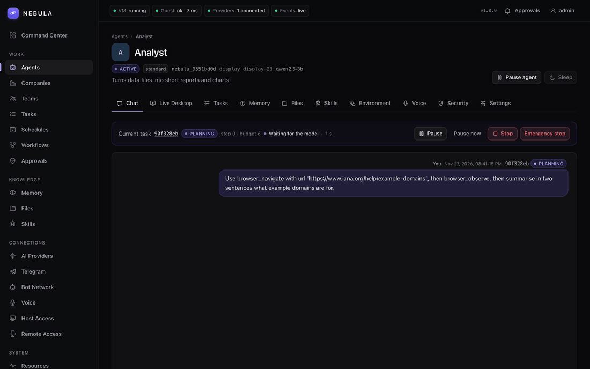
</p>

| | |
|---|---|
| 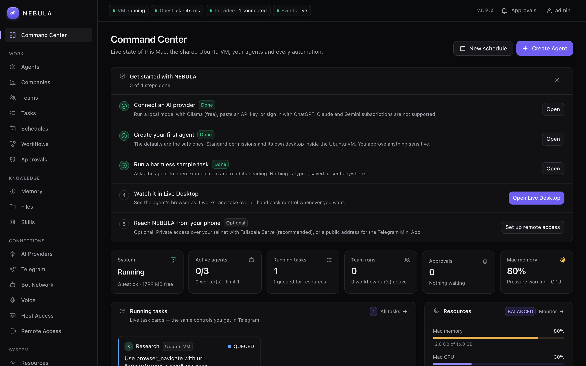 | 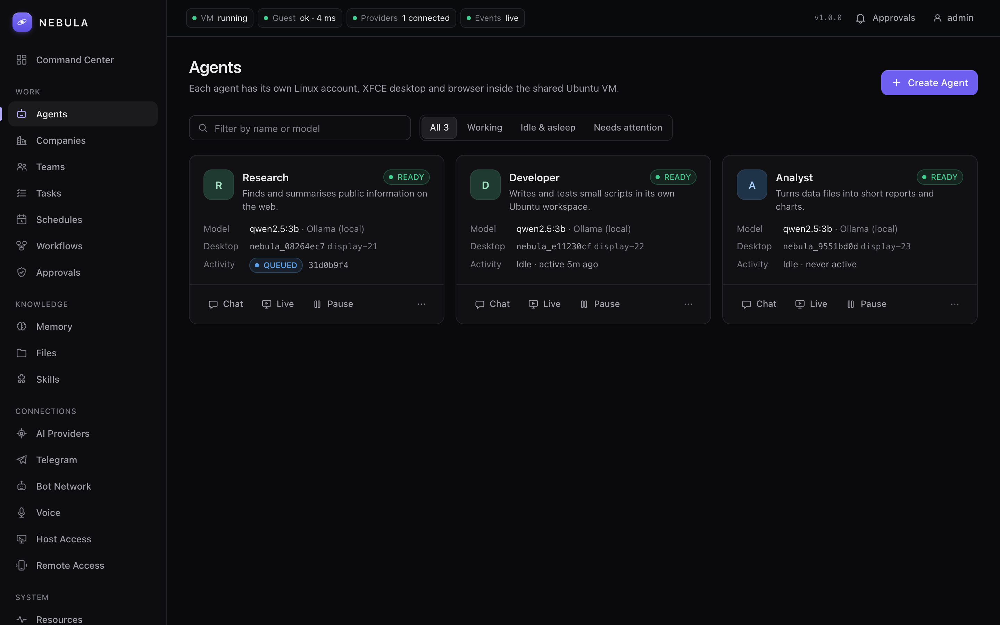 |
| **Command Center**: system, agents, running tasks and approvals | **Agents**: status, model and current task |
| 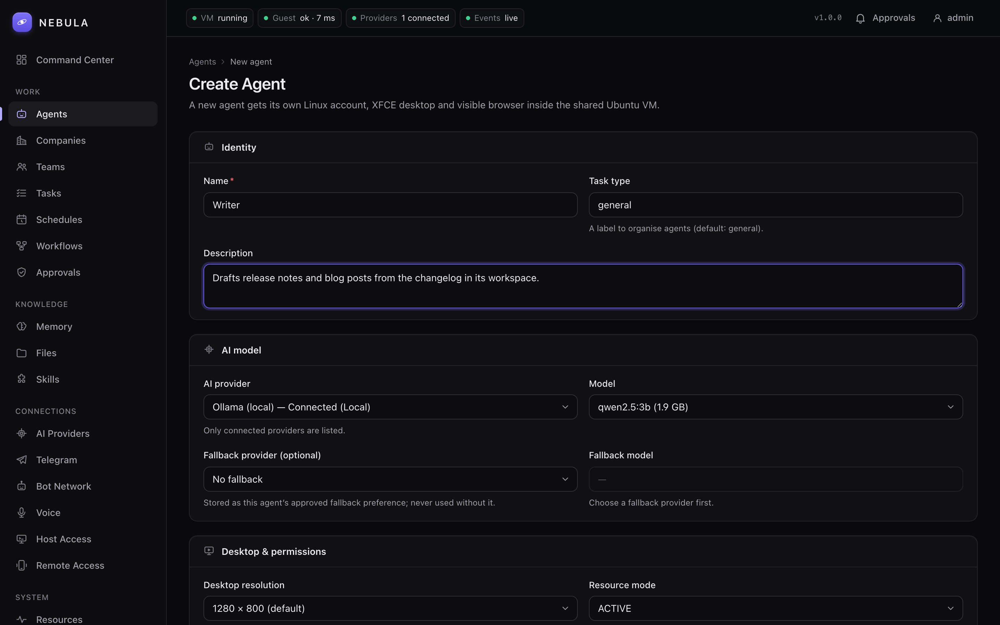 | 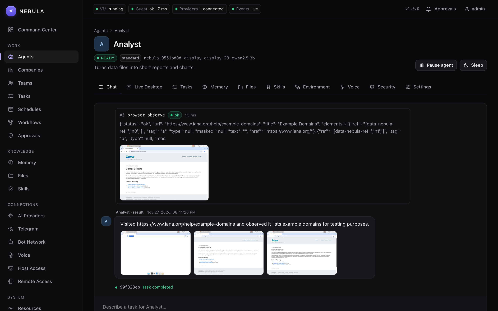 |
| **Create Agent**: provider, model and permission level | **Agent detail**: chat, tasks, memory, files and settings |
| 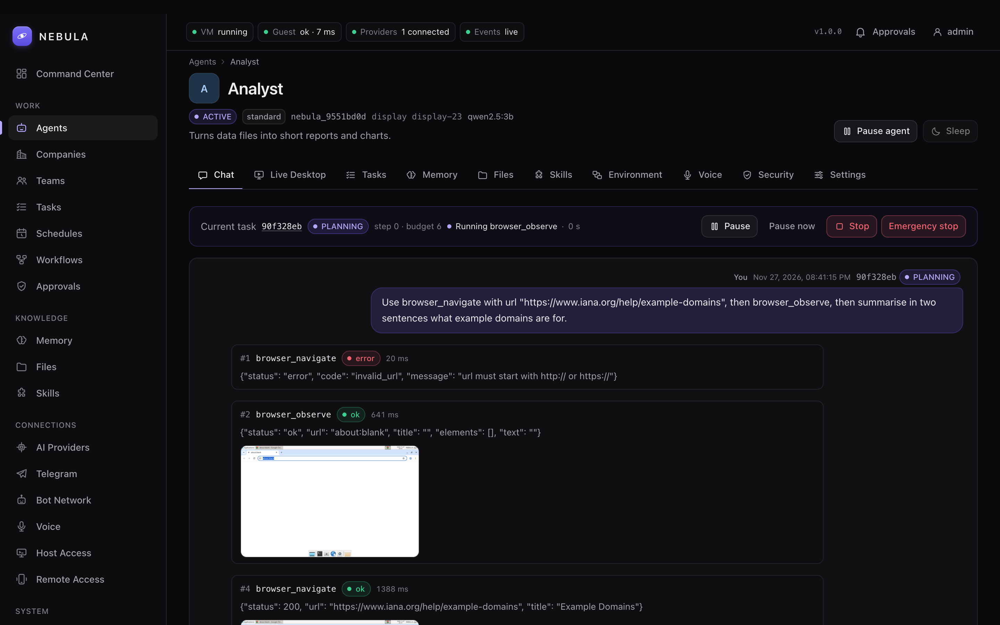 | 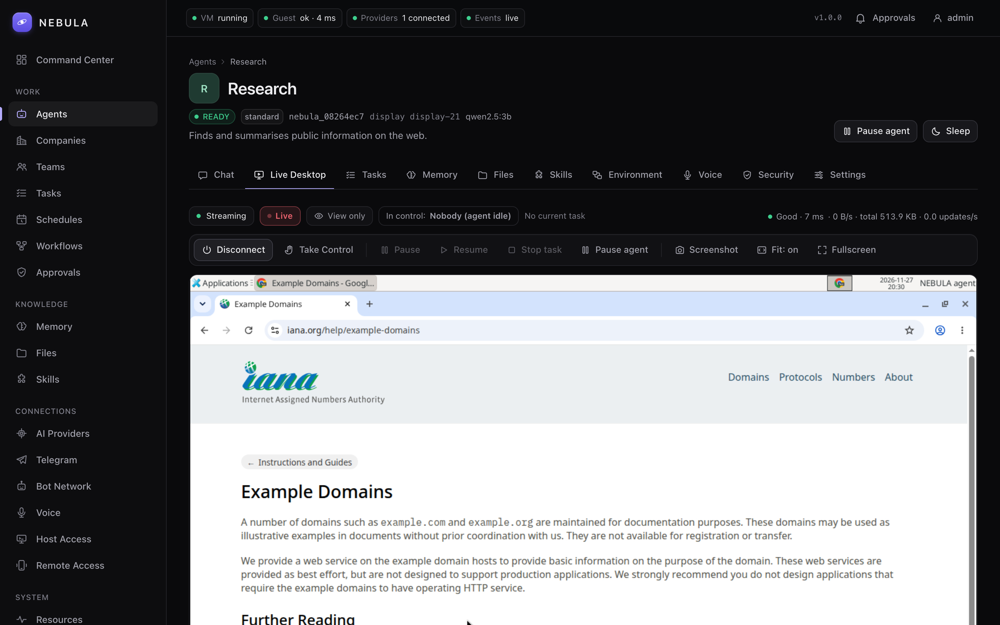 |
| **A running task** with live steps and evidence | **Live Desktop**: the agent's real screen |
| 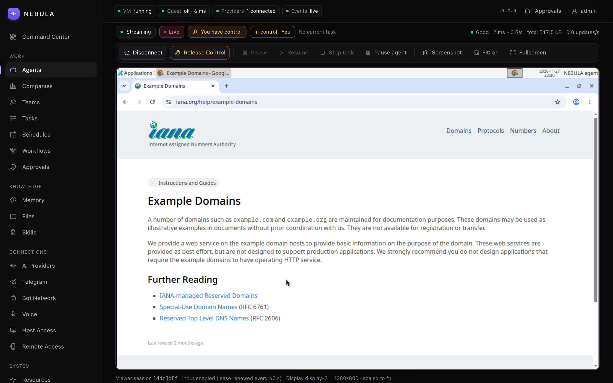 | 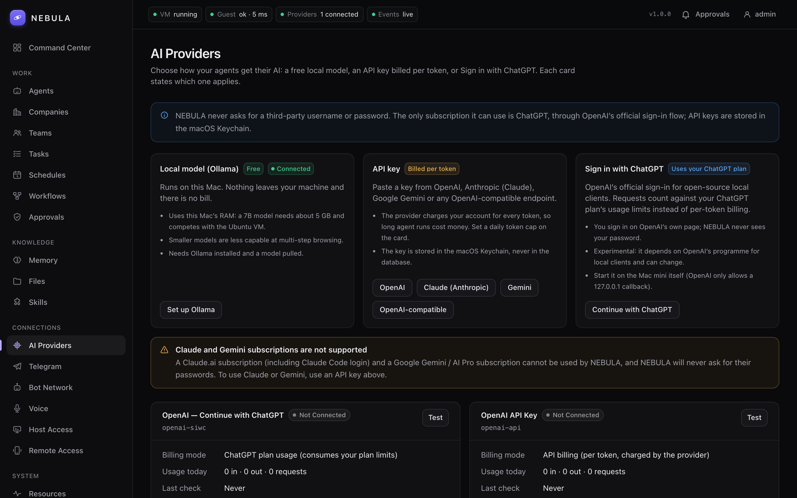 |
| **Take Control**: you drive, the agent waits | **AI Providers**: local, API key and official sign-in |
| 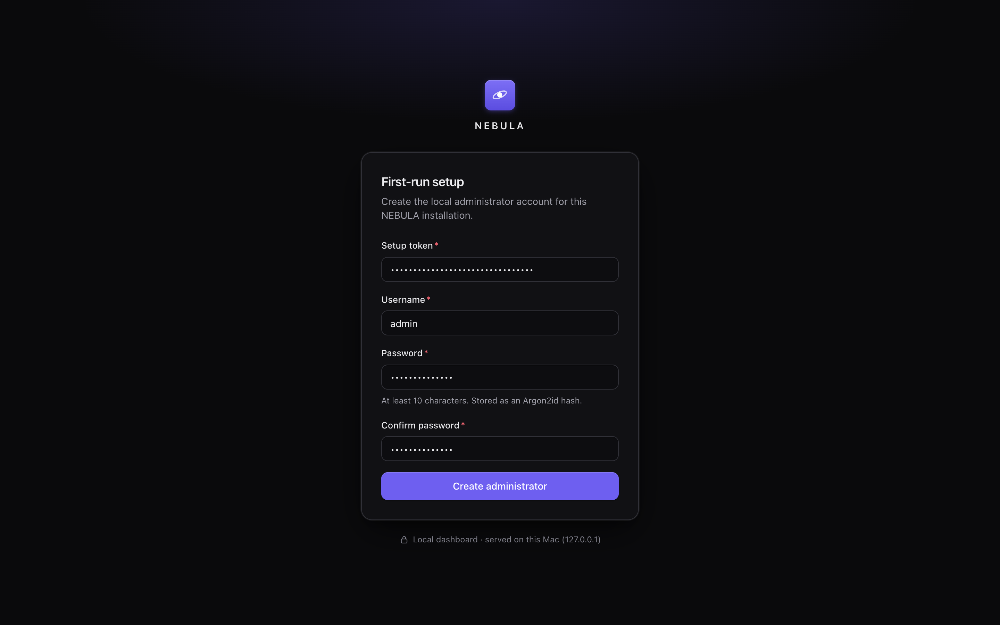 | 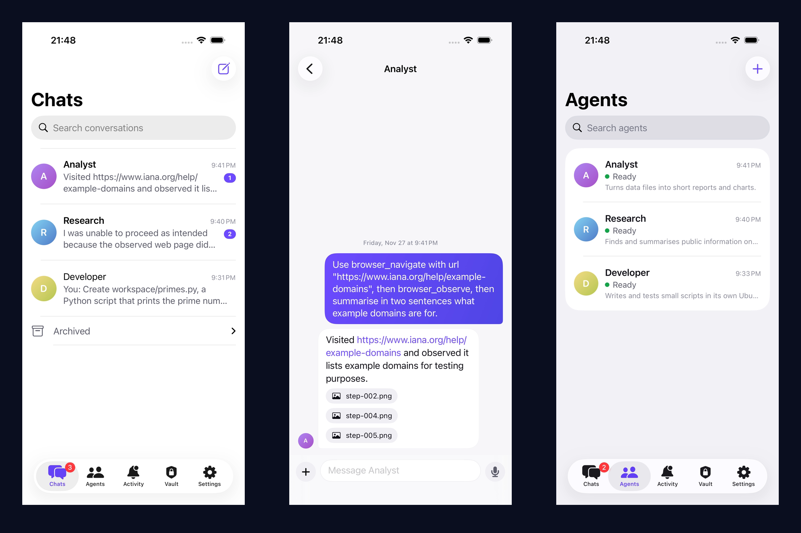 |
| **First run**: admin account and setup | **iPhone app**: chats, approvals and Live Desktop |
| 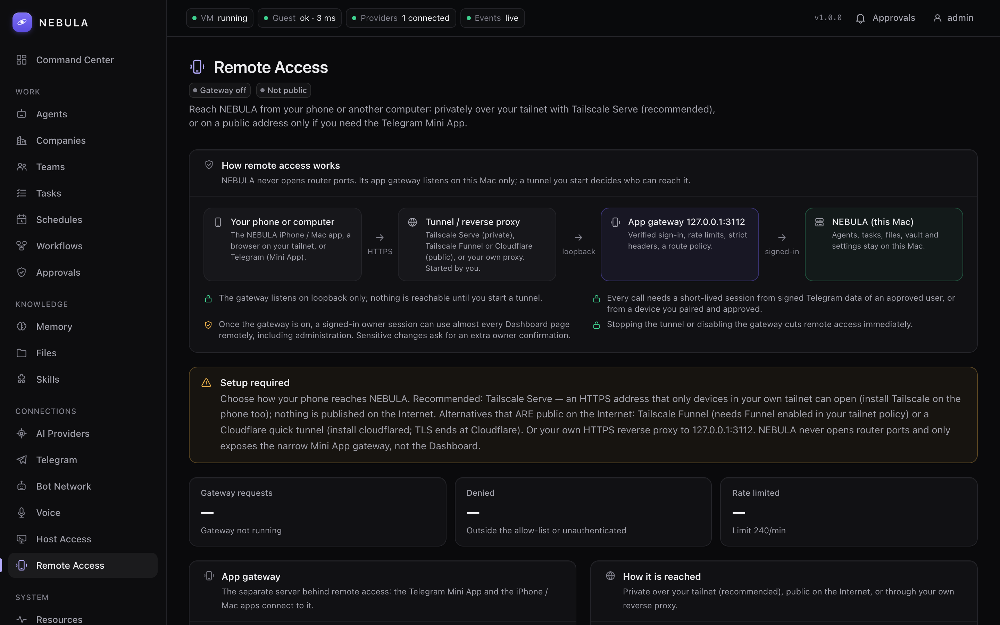 | 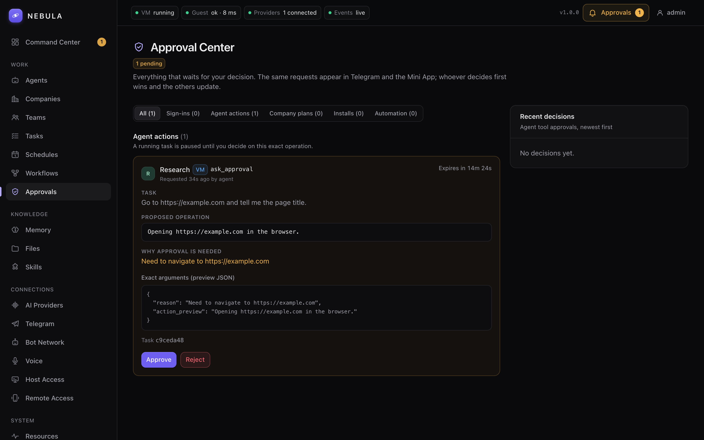 |
| **Remote Access**: gateway and Tailscale Serve | **Approval Center**: the exact operation an agent wants to run |

## Quick start

On an Apple-silicon Mac with the [requirements](#system-requirements) met:

```bash
git clone https://github.com/ond1ej/NEBULA_v1.git && cd NEBULA_v1 && ./install.sh
```

The installer checks the Mac, builds NEBULA, downloads and verifies the Ubuntu image, creates and provisions the VM,
runs a health check and prints a one-time link such as `http://127.0.0.1:3100/#/setup?token=...`. Open it on the
same Mac to create your administrator account. Most of the first install is spent downloading the Ubuntu image
(about 600 MB) and provisioning the VM, which takes several minutes.

Details, options, updating and uninstalling: [docs/installation.md](docs/installation.md).

## System requirements

| | Minimum | Recommended |
|---|---|---|
| Mac | Apple silicon (M1 or later). Intel Macs are refused. | An always-on Mac mini |
| macOS | 13 Ventura or later | The latest macOS release |
| Memory | 8 GB (at least 4 GB always stays for macOS) | 16 GB or more, especially with local models |
| Disk | 25 GB free | 50 GB or more free; the VM disk grows up to 32 GB, local models need their own space |
| Network | Internet access for the first install (Ubuntu image and packages) | A wired connection for an always-on host |
| Tools | Xcode Command Line Tools, `uv`, Node.js 20.19+ on Node 20, or 22.12+ (Node 21 is not supported), with `pnpm` | The installer checks each one and offers to install what is missing |

`./install.sh --check` reports all of this without changing anything. The installer stops with a plain message
before changing anything when a hard requirement is not met. On Macs with 16 GB or less, the VM gets 4096 MB. The
native apps are built from the separate [NEBULA-iOS](https://github.com/ond1ej/NEBULA-iOS) repository and need Xcode 26 or later
(iOS 26 and macOS 26 SDKs) on the Mac that builds them; they run on iOS 18 or macOS 15 or later.

## Installation

```bash
./install.sh
```

`install.sh` is the single entry point. It checks the Mac, offers to install missing tools (each with a question;
`--yes` accepts all), sets up the Python environment from the lockfile with `uv`, builds and ad-hoc signs the Swift
VM helper, builds the dashboard and runs `nebula install`, which:

1. **Preflight**: macOS and CPU, Virtualization entitlement, RAM, disk, write access, network, port, sleep policy.
2. **Download and verify**: the pinned Ubuntu 24.04 ARM64 cloud image from `cloud-images.ubuntu.com`, checked against
   an Ed25519-signed manifest, its SHA-256 and Ubuntu's GPG-signed `SHA256SUMS` (when `gpg` is installed).
3. **Create the VM**: per-install SSH keys with a pinned guest host key, a random host-to-guest RPC key in the
   Keychain, a cloud-init seed and a sparse disk.
4. **Provision the guest**: hardening, XFCE, TigerVNC, Playwright Chromium, the NEBULA guest service and a firewall.
5. **Health check**: host-to-guest RPC, a temporary desktop, a headed browser and a non-empty screenshot.
6. **Service**: copies the runtime out of your checkout, asks whether NEBULA should start after login (a per-user
   LaunchAgent, `--autostart yes|no|ask`), starts it and checks `GET /api/v1/health`.

Re-running the installer is safe: finished steps are skipped and an existing VM is reused, never overwritten.

```bash
./install.sh --check             # report only, changes nothing
./update.sh                      # newest release tag: DB backup, build, migrate, health check, rollback on failure
./uninstall.sh                   # stop the VM and remove the service; keeps all data
.venv/bin/nebula status          # installation, VM and service state
.venv/bin/nebula health          # HTTP health check of the running service
.venv/bin/nebula restart         # restart the service and health-check it
.venv/bin/nebula doctor          # preflight plus a live VM health check
.venv/bin/nebula diagnostics     # redacted support bundle
```

See [docs/installation.md](docs/installation.md) for every option, updates, autostart and complete removal.

## First run

1. Open the setup link that the installer printed. Lost it? Run `.venv/bin/nebula setup-url`. The link only works
   on this Mac and only until the first administrator exists.
2. Create the administrator account (password of 10 characters or more, stored as an Argon2id hash). There are no
   default credentials.
3. **AI Providers**: connect at least one provider. The quickest free start is Ollama with a tool-capable model.
4. **Create Agent**: name, provider, model and permission level (`READ_ONLY`, `STANDARD` or `ADVANCED`). NEBULA
   creates the agent's Linux user, desktop and browser profile in the VM.
5. **Chat**: give a first task, for example *"Open https://example.com and save its main heading to heading.txt"*.
   Steps, screenshots and approval requests stream into the chat.
6. **Live Desktop**: press **Connect** to watch, **Take Control** to drive, **Release Control** to hand back.

The full walkthrough is in [docs/getting-started.md](docs/getting-started.md).

## AI providers

Dashboard → **AI Providers**. Keys are stored in the macOS Keychain; the database keeps only a reference.

| Provider | How you connect | Billing | Status |
|---|---|---|---|
| Ollama | Install Ollama, pull a tool-capable model (for example `ollama pull qwen2.5:7b`), press **Test connection** | Local, uses your Mac's RAM | Stable |
| OpenAI API | Paste an API key | Per token, by OpenAI | Experimental |
| Anthropic API | Paste a Claude API key | Per token, by Anthropic | Experimental |
| Google Gemini API | Paste a Gemini API key | Per Google's API terms | Experimental |
| OpenAI-compatible | Base URL (HTTPS, or HTTP on loopback) plus a key | As declared by you | Experimental |
| Sign in with ChatGPT | **Continue with ChatGPT** on the Mac, using OpenAI's documented sign-in for local open-source clients | Your ChatGPT plan's usage limits | Experimental |

**Not supported:** Claude (claude.ai) and Gemini consumer subscriptions, and running the Claude Code, Codex or
Antigravity CLIs on your behalf. NEBULA never asks for a ChatGPT, Claude or Google password, never reads browser
cookies and never calls private web endpoints of a subscription. Details: [docs/providers.md](docs/providers.md).

## Remote access with Tailscale

By default NEBULA is reachable only from the Mac itself. For your phone or laptop the recommended path is
[Tailscale](https://tailscale.com):

1. Install Tailscale on the Mac and on your devices, signed in to the same tailnet, with MagicDNS and HTTPS
   certificates enabled in the tailnet settings.
2. Dashboard → **Remote Access** → enable the gateway (it listens on `127.0.0.1`, by default on the dashboard port
   plus 2, for example `3102`).
3. Choose **Tailscale Serve** and start it. NEBULA runs `tailscale serve` for this instance's HTTPS port only
   (default `443`) and leaves every other Serve or Funnel entry of the Mac alone. The gateway becomes available at
   `https://<your-mac>.<your-tailnet>.ts.net` to devices in your tailnet only.

The gateway does not serve the web dashboard or its password sign-in. It serves the Mini App and the native apps and
forwards API calls only for authenticated sessions, and an authenticated owner session can administer NEBULA through
it.

**Tailscale Funnel** and **Cloudflare quick tunnels** publish the gateway to the whole Internet. They exist because
Telegram Mini Apps need a public HTTPS origin, they need an explicit confirmation, and they expose owner
administration behind the gateway's authentication. Read [docs/remote-access.md](docs/remote-access.md) before you
enable one.

## Live Desktop

Every agent's desktop is an Xvnc display inside the VM that listens only on a Unix socket. When you press
**Connect**, the host opens an authenticated, single-use tunnel for exactly that agent and the dashboard renders it
with noVNC. The view is read-only until you press **Take Control**, which takes an exclusive, renewable control lease
and pauses the agent's GUI actions. **Release Control** hands it back and the agent looks at the screen again before
it continues. **Disconnect** stops the stream; the agent keeps working. See [docs/live-desktop.md](docs/live-desktop.md).

## iOS companion app

The iPhone, iPad and Mac apps live in their own repository: **[ond1ej/NEBULA-iOS](https://github.com/ond1ej/NEBULA-iOS)**.
They are not in the App Store or TestFlight: you build and install them from Xcode 26 or later with your own Apple ID.
They connect to your Mac through the remote gateway (Tailscale Serve recommended), pair with a one-time QR code (or the
pairing link pasted into the app) from **Devices** in the dashboard, keep their keys in the Secure Enclave and confirm
sensitive actions with Face ID or Touch ID. Opening the pairing link on the phone does not pair it. See
[docs/ios-app.md](docs/ios-app.md) and, for the server side, [docs/apple-apps.md](docs/apple-apps.md).

## Architecture

<p align="center">
  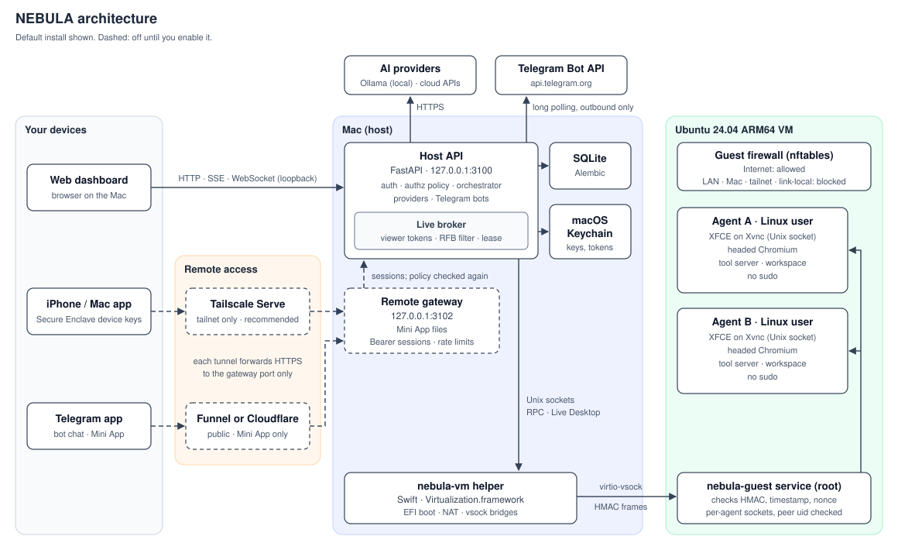
</p>

- The **host API** (FastAPI on `127.0.0.1:3100`) does authentication, the per-route authorization policy, the task
  orchestrator, providers, the Telegram bots and the **live broker** for Live Desktop. State is in SQLite, secrets in
  the macOS Keychain.
- The **remote gateway** (`127.0.0.1:3102`, off by default) serves the Mini App and the native apps through a tunnel
  you choose. It forwards only authenticated sessions, and the host API checks its policy again for every request.
- The **nebula-vm helper** (Swift, Virtualization.framework) runs the VM and bridges Unix sockets on the Mac to
  virtio-vsock. RPC frames to the root **guest service** are HMAC-signed.
- Inside the VM, every agent is a Linux user with its own XFCE desktop on Xvnc, headed Chromium, tool server and
  workspace. The guest firewall lets agents reach the Internet but not your local network.

More detail, including state machines and data ownership: [docs/architecture.md](docs/architecture.md).

## Security model

NEBULA is designed to be safe by default, but it runs AI agents that act on your behalf, and no such system is
invulnerable. The short version:

- **Local by default.** The dashboard and API bind to `127.0.0.1`. LAN access and the remote gateway are off until
  you enable them. NEBULA never configures port forwarding or creates external accounts.
- **Strong local authentication.** First admin only with a one-time setup token, Argon2id passwords, rate limits and
  an account lockout after failed logins (clients on the Mac itself are rate-limited but never locked out), HttpOnly
  SameSite=Strict session cookie, CSRF and Origin checks, Host allowlist, CSP.
- **Secrets in the Keychain.** Provider keys, ChatGPT tokens, the Telegram bot token and the guest RPC key are in the
  macOS Keychain; logs and diagnostics are redacted.
- **Agents work in the VM.** Each agent is an unprivileged Linux user without sudo. All agents share one kernel, so
  the isolation between agents is weaker than separate VMs.
- **The VM keeps agents off your network, not off the Internet.** The guest firewall blocks your LAN, the Mac itself,
  Tailscale (CGNAT), link-local and multicast addresses; you can allow single addresses in
  `/etc/nebula/firewall-lan-allow.nft` inside the VM ([details](docs/configuration.md#vm-network-access)). Internet
  egress is not filtered. For IPv6 only local ranges are blocked, so if the VM gets IPv6 connectivity, devices
  reachable on global IPv6 addresses are not blocked.
- **Approvals are a tripwire, not a sandbox.** Risky-action detection is pattern based. It catches ordinary
  commands but can be bypassed by a determined or prompt-injected agent, for example by sending data out in a plain
  web request. The security boundaries are the VM, the Seatbelt sandbox, the vault's sign-in broker and the rule that
  only you, the owner, can approve. Do not give agents access you would not give a script you have not read.
- **One owner, limited guests.** Other Telegram accounts you approve get only the permissions you store for them, in
  the Mini App and in the bot chat. They never receive approval cards and cannot decide approvals.
- **The remote gateway exposes administration.** Once you enable the gateway and a tunnel, an authenticated owner
  session can use almost the whole API from that origin. Prefer Tailscale Serve, which stays inside your tailnet;
  Funnel and Cloudflare tunnels are public and only needed for the Telegram Mini App.
- **Host execution is opt-in.** Agents can work in Mac folders you authorise, inside a Seatbelt sandbox, with network
  access off unless you turn it on per folder. Even with network on, host commands cannot reach the Mac itself
  (loopback, LAN or VM bridge address; measured on macOS 27.0.1); other destinations are not blocked. That is the most
  sensitive feature; it is off until you add a folder.

Read [docs/security-model.md](docs/security-model.md) for the threat model and what is enforced versus advisory.
Report vulnerabilities privately as described in [SECURITY.md](SECURITY.md).

## Troubleshooting

Start with `.venv/bin/nebula doctor`. It prints every preflight check and a live health check as JSON and exits
non-zero when something fails. Common fixes:

| Symptom | Fix |
|---|---|
| `virtualization: fail` | Build and sign the helper again: `make helper` |
| Port 3100 in use | Install with another port, for example `--port 3200` |
| Install stuck at `VM_BOOT` | Check `~/Library/Application Support/NEBULA/vm/shared/console.log` |
| Guest unreachable, VM at high CPU | The Mac is swapping: stop large local models, lower the VM RAM, restart the VM |
| Task waits in `WAITING_PROVIDER` | Provider quota, sign-in or RAM; fix the cause and press Resume |
| macOS asks for Keychain access | Choose **Always Allow** for the NEBULA runtime's Python |

More in [docs/troubleshooting.md](docs/troubleshooting.md) and the [FAQ](docs/faq.md). For a bug report, attach the
diagnostics bundle from **System → Export diagnostics** (secrets are redacted).

## Roadmap

Planned work includes a signed and notarized Mac app, a prebuilt VM image, Internet egress rules for agents (local
network destinations are already blocked), live VM snapshots, workspace quotas and screenshot masking. Nothing on the
roadmap is promised for a date. See [docs/roadmap.md](docs/roadmap.md).

## Documentation

| | |
|---|---|
| [Getting started](docs/getting-started.md) | [Installation](docs/installation.md) |
| [Configuration](docs/configuration.md) | [AI providers](docs/providers.md) |
| [Remote access](docs/remote-access.md) | [Live Desktop](docs/live-desktop.md) |
| [iPhone and Mac apps](docs/ios-app.md) and [their server side](docs/apple-apps.md) | [Telegram](docs/telegram.md) |
| [Architecture](docs/architecture.md) | [Security model](docs/security-model.md) |
| [Features](docs/features/) | [Known limitations](docs/limitations.md) |
| [Troubleshooting](docs/troubleshooting.md) | [Testing](docs/testing.md) |
| [FAQ](docs/faq.md) | [HTTP API](docs/api.md) and [design decisions](docs/decisions.md) |

## Contributing

Contributions are welcome. Read [CONTRIBUTING.md](CONTRIBUTING.md) for the development setup and the checks a pull
request must pass, and follow the [Code of Conduct](CODE_OF_CONDUCT.md). Please report security issues privately
([SECURITY.md](SECURITY.md)), not in public issues.

## License

NEBULA is released under the [MIT License](LICENSE). Third-party components keep their own licenses; the web
dashboard bundles noVNC (MPL-2.0). See [THIRD_PARTY_NOTICES.md](THIRD_PARTY_NOTICES.md).

Apple, macOS, iOS and Mac mini are trademarks of Apple Inc. Ubuntu is a trademark of Canonical Ltd. Tailscale,
Telegram, OpenAI, ChatGPT, Anthropic, Claude, Google, Gemini and Ollama are trademarks of their respective owners.
NEBULA is an independent project and is not affiliated with or endorsed by any of them.
