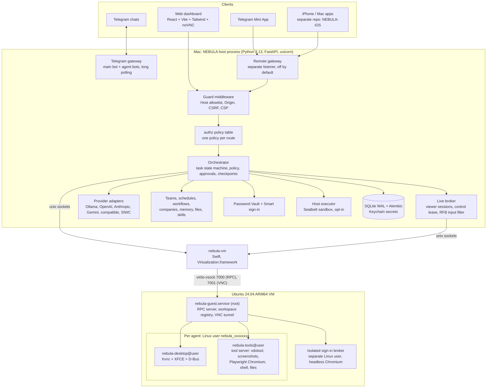

# Architecture

NEBULA has one server process on the Mac, one helper process that runs the VM, one Ubuntu VM with a root guest
service and one unprivileged Linux user per agent, plus optional clients (web dashboard, Telegram, Mini App, native
apps). There is no cloud component.

## Overview

## Components

| Component | Path | Role |
|---|---|---|
| Host API | `apps/host-api/nebula_host` | FastAPI app: authentication, the policy table (`authz.py`), agents, tasks, approvals, live desktop, providers, Telegram, remote gateway (`remote.py`), LAN listeners (`lan.py`), vault, devices, events (SSE), diagnostics, backups |
| Installer and CLI | `apps/setup/nebula_setup` | `nebula` command: preflight, image download and verification, QCOW2 to raw conversion, cloud-init seed, provisioning, health check, LaunchAgent, runtime deployment, repair, uninstall |
| VM helper | `apps/host-vm-helper` | Swift `nebula-vm`: EFI boot, virtio block (sparse raw disk), NAT networking, virtio console log, virtio-vsock with Unix-socket bridges, control socket |
| Agent runtime | `packages/agent-runtime/nebula_runtime` | Orchestrator loop, tool catalogue, policy and approval classification |
| Provider adapters | `packages/provider-adapters/nebula_providers` | One adapter per provider, all with `test_connection`, `list_models`, `stream_turn`, `estimate_cost_or_plan`, `revoke` |
| Telegram gateway | `packages/telegram-gateway/nebula_telegram` | Bot API client, pairing, topics, commands, cards, agent bots; `access.py` maps every chat command, button and voice intent to the API permission it needs (approvals: the owner only) |
| Live broker | `packages/live-broker/nebula_live` | Viewer sessions, control lease, RFB parsing and input filtering |
| Contracts | `packages/contracts` | Host-guest RPC framing (HMAC), generated OpenAPI contract |
| Dashboard and Mini App | `apps/dashboard` | React + TypeScript + Vite + Tailwind; `index.html` (dashboard) and `mini.html` (Mini App) |
| Guest | `guest/` | Guest service, desktop session units, provisioning script, image manifest and keys |
| Migrations | `migrations/` | Alembic migrations of the SQLite schema |
| Tests | `tests/` | `unit`, `integration`, `security` (pytest) |
| Scripts | `scripts/` | Developer setup, hardware end-to-end harness, test instance, release build, API doc generator |

The iPhone, iPad and Mac apps are not part of this repository. They are clients of the remote gateway and live in
[NEBULA-iOS](https://github.com/ond1ej/NEBULA-iOS); the server side of pairing is in `apps/host-api/nebula_host/devices.py`.

## Process model

- **One host process.** Everything on the Mac runs inside one uvicorn process, started by the LaunchAgent (or by
  `nebula serve` in the foreground). Short-lived child processes are used for sandboxed host commands, `say`,
  `ffmpeg`, `pdftotext` and `whisper-cli`. There is no process per bot and no resident speech model.
- **Listeners.** The dashboard and API listen on `127.0.0.1:<port>`. Optional LAN listeners are extra servers in the
  same process bound to private addresses of physical interfaces. The remote gateway is another listener on
  `127.0.0.1`, started only when enabled.
- **The VM helper** is a separate signed binary (`nebula-vm`) with the `com.apple.security.virtualization`
  entitlement. It owns the virtual machine and bridges host Unix sockets (mode `0600`) in the data directory to guest
  vsock ports: `7000` for RPC and `7001` for the VNC tunnel.
- **The runtime is a copy.** A LaunchAgent cannot read folders such as `~/Desktop` without a privacy prompt, so
  install and deploy copy the code into `<data>/app/<version>` with its own virtual environment, and the service runs
  from there.

## Host to guest channel

Every RPC frame carries an HMAC-SHA256 over the payload with a timestamp and a nonce (replay cache). The 32-byte key is
generated per install, stored in the Keychain on the host and in `/etc/nebula/rpc.key` (root, `0600`) in the guest.
The guest's only IP service is SSH, key-only, for one admin user, and the guest firewall accepts it only from the VM's
NAT gateway; it is used for provisioning and repair. The guest's SSH host key is generated on the host and injected
through cloud-init, so it is pinned from the first connection.

## Inside the VM

- **One shared VM**, 6 GiB and 4 vCPUs by default, Ubuntu 24.04 LTS cloud image booted with EFI (so the guest's own
  kernel updates keep working). No memory balloon device (see [decisions.md](decisions.md) D30).
- **Per agent:** a Linux user `nebula_<first 8 hex digits of the agent id>` with a `0700` home, its own X cookie,
  D-Bus session and runtime directories, and two systemd units: `nebula-desktop@<user>` (Xvnc on a Unix socket, XFCE)
  and `nebula-tools@<user>` (the tool server, headed Playwright Chromium with a persistent profile). Units use
  `NoNewPrivileges`, `ProtectSystem=full`, `ProtectHome=tmpfs` with a bind of the agent's own home, and memory, CPU
  and task limits. No agent has `sudo`.
- **Files** are changed by running a small helper as the agent's user, so the kernel enforces permissions in addition
  to NEBULA's own path confinement. Team and company folders under `/srv/nebula/shared/` are group-owned.
- **Chromium** keeps its sandbox. An AppArmor profile grants unprivileged user namespaces to that one binary only;
  agents can start it, so they can use user namespaces through it (see
  [security-model.md](security-model.md#known-limits)).
- **Sockets and displays:** the root guest service connects to an agent's tool or VNC socket only after checking
  that the socket is owned by, and served by a process of, that agent's user; an agent's tool server and desktop
  refuse an X display served by another user.
- **Network:** NAT through the Mac. The guest firewall (nftables) keeps Internet egress open and drops traffic to
  local-network destinations (private, CGNAT, link-local and multicast ranges, which includes the Mac and your LAN),
  with owner exceptions in `/etc/nebula/firewall-lan-allow.nft`. See
  [configuration.md](configuration.md#vm-network-access).
- **Plugins** are untrusted: installed only from an uploaded ZIP, stored read-only, run as the calling agent's user
  with a timeout, always through the policy engine.
- **Sign-in broker:** the vault's sign-in browser runs as a separate Linux user per session in the VM; agents never
  see the passwords it types.

## Data

| Store | Holds |
|---|---|
| `nebula.db` (host) | Agents, tasks, steps, checkpoints, messages, conversations, memory (FTS5), providers (references), Telegram mappings, live sessions, approvals, audit log, events, teams, schedules, workflows, companies, attachments metadata, vault ciphertext, devices |
| Keychain (host) | Provider keys, ChatGPT credentials, Telegram bot tokens, guest RPC key, server key for app pairing, APNs key |
| Data directory (host) | VM bundle, artifacts, attachments, keys for SSH and the LAN CA, runtime copy, `config.yaml` |
| Guest | `/home/nebula_*` (workspace, browser profile, desktop config), agent registry, RPC key, `/opt/nebula` (guest service, virtual environment, Playwright browsers) |

The VM can be stopped and restarted without losing conversations or tasks; they live on the host. After a host
restart, interrupted tasks resume from their checkpoints, and desktops that were active are restarted by the guest
service on boot.

## State machines

- **Installer:** `NOT_INSTALLED → PREFLIGHT → DOWNLOAD → VERIFY → DISK_CREATE → VM_BOOT → GUEST_PROVISION →
  HEALTHCHECK → READY`, with `FAILED_RECOVERABLE`, `FAILED_BLOCKED` and `ROLLBACK`.
- **Agent:** `CREATING → READY ⇄ ACTIVE`, plus `PAUSED`, `SLEEP` (desktop stopped, files kept), `ERROR`, `DELETING`.
- **Task:** `RECEIVED → QUEUED → PLANNING → EXECUTING → (WAITING_APPROVAL | WAITING_CONTROL | WAITING_PROVIDER) →
  VERIFYING → COMPLETED | FAILED | CANCELLED`, and `PAUSING → PAUSED → QUEUED` on resume.
- **Live session:** `DISCONNECTED → CONNECTING → VIEWING → DISCONNECTING → DISCONNECTED`, plus `ERROR_RETRYABLE`.

## The agent loop

`TaskRunner.run()` loads the checkpoint, builds a provider-neutral transcript (recent conversation plus memory search
hits, marked as data), and calls `stream_turn()` on the adapter with the tools allowed at the agent's permission
level. For every tool call:

1. The policy decides: allow, ask for approval, or deny.
2. The Take Control gate and a per-agent GUI lock are checked.
3. Side-effecting calls are written to the checkpoint as `in_flight` before they run; after a crash they become
   `outcome_unknown` and are never replayed automatically.
4. The tool runs in the guest (or, for host agents, in the host executor).
5. The step, an evidence screenshot, an audit record and an event are stored, and the checkpoint is updated.

`task_complete` must name artifacts that the runtime verifies in the guest; a task that changed something but proves
nothing does not become `COMPLETED`. `max_steps` caps both tool calls and model requests.

Teams, schedules, workflows and company runs never call models themselves: they create ordinary agent tasks, so every
guarantee above applies to automation too. An `origin_depth` counter, run limits and bounded loops keep automation
from triggering itself without end.

## Resource management

At most `agents.default_active_limit` tasks execute at the same time; others wait in `QUEUED` with a visible reason.
The resource manager turns the ECO, BALANCED or PERFORMANCE profile, the measured free memory in the guest and the
Mac's memory pressure into effective limits. A task starts only with at least 700 MB available in the guest (1200 MB
to wake a sleeping desktop); with `resource_policy: sleep_lru` the least recently used idle desktop is put to sleep
first. Critical memory pressure on the Mac blocks new starts. Local inference runs one request at a time. Design notes:
[design/resource-manager.md](design/resource-manager.md).

## Remote access path

The remote gateway is a separate FastAPI app on its own loopback port. It serves the Mini App's static files,
authenticates Mini App and native app sessions, and forwards `/api/v1/*` requests to the main API on loopback with the
session and a per-process secret header that proves the request came through the gateway. The main API then applies
the same policy table to every request, so an authenticated owner session can administer NEBULA through the gateway.
Live Desktop has its own WebSocket route on the gateway. Tunnels (Tailscale Serve or Funnel, Cloudflare) are separate
programs that forward HTTPS to that port; NEBULA scopes Tailscale to this instance's HTTPS port and never touches
other Serve or Funnel entries. See [remote-access.md](remote-access.md).

## Further reading

- [decisions.md](decisions.md): design decisions and the reasons behind them
- [security-model.md](security-model.md): trust boundaries and threats
- [features/](features/): host execution, companies, automation, attachments, voice, vault, Smart sign-in
- [design/mini-app.md](design/mini-app.md): Mini App design
- [api.md](api.md): HTTP API reference (generated)
